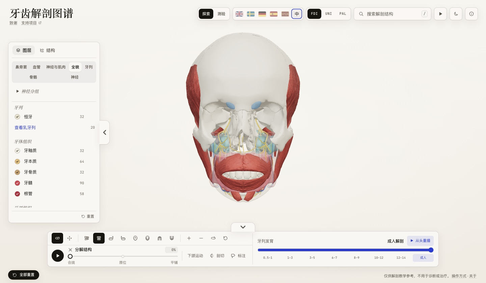

# 牙齿解剖图谱 · Dental Scope

简体中文 · [English](README.en.md)

在浏览器中旋转颌骨、选中一颗牙，再从牙釉质逐层看到牙髓和根管。这个版本默认使用**简体中文**，支持中文搜索、三维标注、结构说明、操作导览和认牙测验。

**仅供教学。** 模型和文字不能用于诊断、治疗规划或判断个人的牙齿状况；解剖说明仍待口腔专业人员审核。



## 本地运行

安装 Node.js 22.12 或更新版本和 pnpm 后，在项目根目录运行：

```bash
pnpm install --frozen-lockfile
pnpm dev
```

打开终端显示的本地地址。首次打开即为中文；如果浏览器记住了其他语言，点击顶部的 **「中」**，或在窄屏的语言菜单中选择 **「简体中文」**。链接末尾加 `?lang=zh` 也可直接打开中文版。

## 从一颗牙开始

1. 按 `/` 搜索 **左下第一磨牙**、**36号牙** 或 **智齿**。也可以搜索 **牙釉质**、**下牙槽神经** 等结构。
2. 选择 **左下第一磨牙**，在详情中对照三种牙位编号：FDI **36**、通用编号 **#19**、Palmer **LL6**。左右均以模型人物自身为准。
3. 选择 **查看这颗牙的内部**，切换解剖层级或拖动剖切面。按 `Esc` 返回全口。
4. 切换到 **测验**，在打乱排列的恒牙中找出目标牙；也可通过 **牙列发育** 时间轴比较乳牙列和替牙期模型。

当前版本保留英语、瑞典语、德语、西班牙语和拉丁语。切换语言不会改变牙位编号。中文静态指南位于构建后站点的 `/about/zh/`；可以在不加载三维模型的情况下阅读。

## 主要操作

| 操作 | 方法 |
| --- | --- |
| 旋转、平移、缩放 | 拖动、右键拖动、滚轮；触屏可单指旋转、双指平移或捏合 |
| 选择、聚焦结构 | 单击选择，双击或 `F` 聚焦 |
| 单独显示／隐藏／半透明 | `I` ／ `H` ／ `G` |
| 查看内部、切换层级 | `D` 进入；`[` 和 `]` 切换层级 |
| 分解、剖切、标注 | `E` ／ `C` ／ `L` |

## 开发与构建

```bash
pnpm test            # 单元测试（含各语言内容覆盖检查）
pnpm typecheck       # 应用类型检查
pnpm typecheck:tests # 测试与构建配置类型检查
pnpm lint            # 代码检查
pnpm build           # 生成可静态托管的 dist/
pnpm preview         # 本地预览构建产物
```

浏览器测试：先运行 `pnpm exec playwright install chromium`，再运行 `pnpm test:e2e`。若部署在仓库子路径下，请按实际路径设置 `DS_BASE`，例如 `DS_BASE=/dental-scope/ pnpm build`。

| 目录 | 内容 |
| --- | --- |
| `src/i18n/` | 界面文字、结构名称、测验提示与导览 |
| `src/content/zh/` | 中文牙齿、牙体组织和周围结构说明；其他专业条目在 `src/content/` 的多语言表中 |
| `src/anatomy/`、`src/engine/` | 解剖结构注册表与 Three.js 渲染引擎 |
| `src/ui/`、`src/app/` | React 面板、导航和静态指南页面 |

更多技术细节见[架构说明](docs/architecture.md)和[内容审核说明](docs/content.md)（英文）。

## 来源与许可

本项目基于 [Yoosseph/dental-scope](https://github.com/Yoosseph/dental-scope)。颌骨和牙齿等模型衍生自 **BodyParts3D**（© The Database Center for Life Science，CC BY-SA 2.1 日本版）；多数神经及血管的走行参考 **Z-Anatomy**（CC BY-SA 4.0）。牙体内部及部分结构为教学建模，不是个体影像测量结果。

代码采用 [MIT 许可](LICENSE)，教学文字采用 CC BY-SA 4.0。模型来源和各自许可见[完整署名](CREDITS.md)及[资源清单](docs/assets.md)。
